<b>一个人做产品。把 AI 从对话框里请出来，放进毛绒玩具、回忆网站和一支 AI 团队里。下面每个项目都还在长大。</b> 
<b>Building solo, taking AI out of the chat box and into plush toys, memory websites and a team of agents. Every project below is still growing.</b>

  

## 🧸 ai-plush-companion

<b>把会听、会说、会记得你的心，缝进毛绒玩具。</b>一只跑在 ESP32 上的 AI 陪伴玩偶：固件、语音服务、MQTT 网关和管理后台都在这一个仓库里。天气、新闻、搜索这些能力做成 Skill，按设备单独下发。 
<b>Sewing a heart that listens, talks and remembers into a plush toy.</b> An AI companion running on ESP32, with firmware, voice runtime, MQTT gateway and management console in one repo. Abilities like weather, news and search ship as Skills, bound per device.

## 💌 memory-website-builder

<b>把相册里散落的日子，串成一条能走回去的路。</b>一个 Claude Skill：回答几个问题，传几张照片，它会读出时间和地点，排成一条故事路线，再把整个网站和部署脚本交到你手里。不会写代码也能用。 
<b>Stringing the days in your camera roll into a path you can walk back along.</b> A Claude Skill: answer a few questions, add some photos, and it reads the dates and places, lays them out as a story route, then hands you the whole site with deploy scripts. No coding needed.

## 🤖 paperclip

<b>一个人的公司，一支不下班的 AI 团队。</b>基于开源 Agent 管理平台 Paperclip，做了三百多次提交的定制：职责卡、模型注册表、统筹看板。我的「一人公司」就跑在它上面。 
<b>A one-person company, run by an AI team that never clocks out.</b> Built on the open-source agent platform Paperclip, with 300+ commits of my own: role cards, a model registry and an ops board. My one-person company runs on it.

## ☯️ ai-links

<b>把出生那一刻的天干地支，排成看得懂的命盘。</b>输入生日，排出四柱、藏干、十神和神煞，再用曲线画出十步大运、百年流年。推演全部在本地规则里完成，不调用 AI 接口，接上支付宝小程序就能收费。 
<b>Turning the stems and branches of a birth moment into a chart you can read.</b> Enter a birthday to get the four pillars, hidden stems, ten gods and stars, with ten decades of luck drawn as a curve. Every reading runs on local rules with no AI calls, and an Alipay mini-program takes payment.

<b>也在折腾 / Also tinkering with</b>：<a href="https://github.com/ShmilyXI/infinite-canvas">infinite-canvas</a>（AI 创作无限画布 / an infinite canvas for AI creation）

